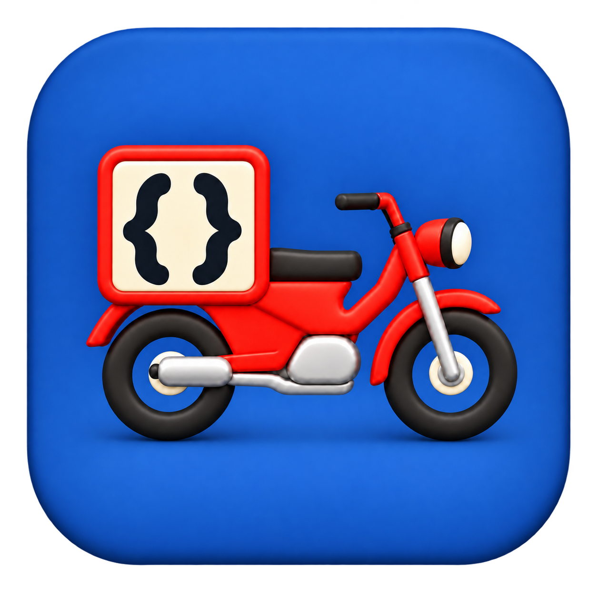

# Postie

<p align="center"></p>

A native macOS HTTP client for personal use. Current work targets macOS 27.0+ and builds with Swift 6/Xcode 27. Layout, snapshots, key transfer and selected ordering/automation behavior have user verification; see [current status](docs/overview.md) for remaining checks.

## Build and run

From the repository directory:

```sh
make app
open dist/Postie.app
make cli
```

The Makefile builds a release app bundle and applies an ad-hoc signature by default. Override `SWIFT`, `BUILD_DIR`, `APP_DIR` or `CONFIGURATION` on the make command line when needed. OTA/distribution work remains deferred; local builds do not deploy infrastructure. HTTP and HTTPS are allowed for an explicit API client; normal server-certificate validation remains enabled.

For an isolated development workspace, launch with explicit directories:

```sh
open --new dist/Postie.app --args \
  --data-directory /Volumes/Data/tmp/postie-demo/data \
  --body-directory /Volumes/Data/tmp/postie-demo/bodies
```

Otherwise saved collections live in `~/.config/postie`, with one versioned JSON file per request and an ordered collection index. Existing Application Support or test stores are not moved or merged automatically; use `--data-directory` to reopen one explicitly. Response bodies are transient unless explicitly saved as snapshots. A second writer to the same workspace is refused. Marked variables and structured authentication values are encrypted; ordinary literal URLs, headers and bodies, and response bodies may remain plaintext.

## Local verification

```sh
make test
make fixture
```

The Swift fixture binds only loopback, prints its chosen port and serves synthetic echo, redirect, delay, large/chunked and binary responses. Tests build and launch it automatically in isolated temporary workspaces; `make fixture` starts it for manual checks. It is not bundled with the app. In restricted agent execution, build tools require explicit writable caches and an approved invocation outside the outer tool sandbox; see docs/implementation.md. `--disable-sandbox` avoids unsupported nested SwiftPM manifest/plugin sandboxing. Package dependencies are MCP Swift SDK 0.12.1 and SwiftNIO 2.x (minimum 2.65.0).

`make test` and native app/CLI builds require macOS. Linux CI checks formatting, Swift syntax, workflows and whitespace; it does not replace macOS execution. Use `make format`, `make lint` and `make syntax` locally. See [CI notes](docs/ci.md) for toolchain pins and verification boundaries.

## Scope

Rename a request by right-clicking its sidebar row and choosing **Rename request…**, or edit its name above the URL bar. Changes save automatically. Execution settings are under the request **Settings** tab.

Postie provides a side-by-side or stacked request/response editor, ordered query/path/header/body configuration, concurrent request identities with one in-flight execution each, Cancel/Open Request activity navigation, manual redirect following and header inspection, bounded file-backed responses, and saved flat collections. Execution options live in the request Settings tab. Both bodies grow vertically within their pane's outer scroll area; response previews remain bounded.

The initial baseline received independent security, architecture/performance and UI reviews on 2026-10-17; its 46 functional tests passed at that historical checkpoint. This is not a current test result. See [review findings and verification limits](docs/baseline-review.md).

Postie includes scoped variables, structured authentication, encrypted marked secrets, request search, layout choices, saved snapshots, drag ordering and local MCP/CLI automation. Copy as cURL, Paste cURL, HAR export, sync and multi-tab editing remain deferred. See [deferred features](docs/deferred-features.md), [automation](docs/automation.md), and [roadmap](docs/roadmap.md) for current boundaries. Local build checks do not claim CI or distribution success.
